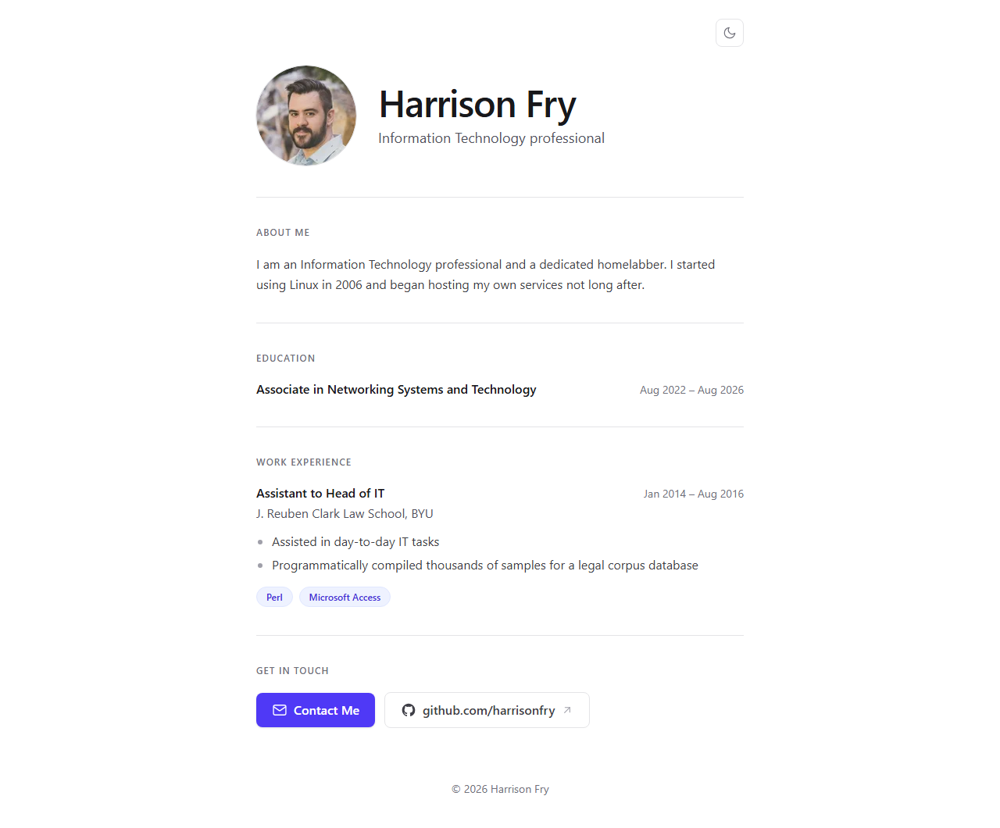
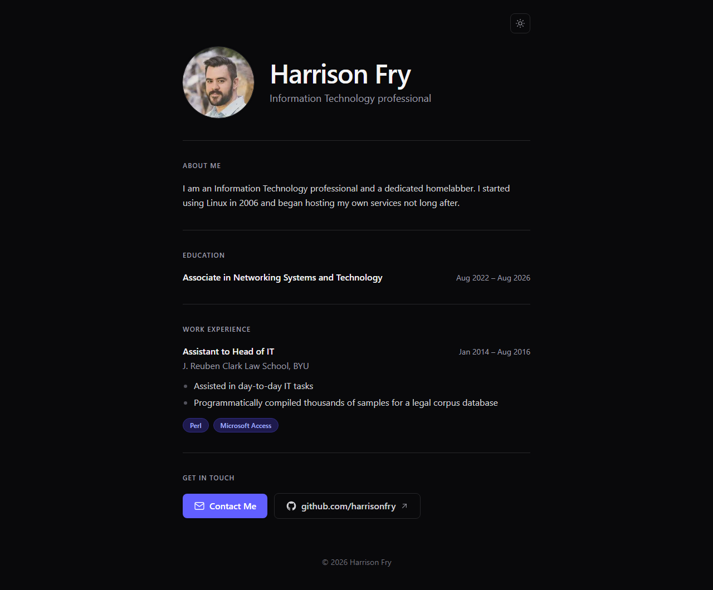

# Personal Website

**Student Name:** Harrison Fry  
**Course:** CIS 260  
**Instructor:** MD Ali  
**Semester:** Fall 2026  
**Project Status:** In Progress

---

## 1. Project Overview

This project is my personal website: a single-page portfolio that introduces me, my education, and my work experience, and gives visitors a way to contact me. It is built as a static site with Astro and Tailwind CSS, packaged into a Docker image served by nginx, and self-hosted on my own VPS. Every push to `main` is automatically built and deployed by a GitHub Actions runner on that VPS, and the site is published to the internet securely through a Cloudflare Tunnel.

I chose this project to take the opportunity to learn about several technologies I had little to no experience in. Mainly web development, Git, and CI/CD pipelines.

The intended users are potential employers, colleagues, and anyone who wants to learn about my background or get in touch with me.

## 2. Project Objectives

- Create a professional online presence at `harrisonafry.com`
- Build a fast, responsive, accessible website that works on desktop and mobile
- Present my education, experience, and contact information in one place
- Host the site with Docker on cloud infrastructure
- Automate deployment so that pushing to GitHub updates the live site

## 3. Features

- Hero header with profile photo, name, and role
- About Me, Education, Experience, and Contact sections
- Light and dark themes
- Responsive, mobile-friendly layout
- Optimized profile image (resized and converted to WebP at build time)
- Custom 404 page
- SEO and link-preview metadata (description, canonical URL, Open Graph tags)
- Automated build and deployment on every push to `main`, with a health check that fails the deploy if the site doesn't come up

## 4. Technologies Used

| Technology | Purpose |
|---|---|
| Astro 7 | Static site framework; builds the site into plain HTML/CSS/JS |
| Tailwind CSS 4 | Styling and responsive layout |
| TypeScript | Site content/config (`consts.ts`) and the theme script |
| Node.js 24 + pnpm | Installing dependencies and running the build |
| Docker (multi-stage build) | Builds the site and packages it into a small nginx image |
| Docker Compose | Defines and runs the website container |
| nginx | Web server inside the container that serves the static files |
| GitHub | Version control and source hosting |
| GitHub Actions (self-hosted runner) | Builds and deploys the site on the VPS on every push |
| Cloudflare Tunnel (`cloudflared`) | Publishes the site to the internet over HTTPS without opening ports on the VPS |
| VPS (Linux) | Server that hosts the runner and the website container |

## 5. System / Architecture Design

### Request flow (how a visitor reaches the site)

```text
Visitor's browser
  |  HTTPS
  v
Cloudflare (DNS + HTTPS for harrisonafry.com)
  |  Cloudflare Tunnel (outbound connection from the VPS)
  v
VPS
  └── Docker network: website-network
        ├── cloudflared container  (tunnel endpoint)
        |     |  HTTP :80
        |     v
        └── personal-website container  (nginx serving the built site)
```

The website container does not publish any ports on the VPS. `cloudflared` reaches it by name (`http://personal-website:80`) over the shared `website-network` Docker network.

### Deployment flow

```text
git push to main
  |
  v
GitHub  ── triggers the "Deploy" workflow (.github/workflows/deploy.yml)
  |
  v
Self-hosted GitHub Actions runner on the VPS
  1. Checks out the repository
  2. Creates website-network if it doesn't exist
  3. docker compose up -d --build
       Dockerfile stage 1 (node:24-alpine): pnpm install + astro build -> dist/
       Dockerfile stage 2 (nginx:alpine):   copy dist/ + nginx.conf
  4. Waits for the container's health check to report "healthy"
  5. Removes old, unused images
```

Pushes that only change `README.md` do not trigger a deploy.

## 6. Installation

### Prerequisites

- [Node.js](https://nodejs.org/) 24 or newer (includes Corepack, which provides pnpm)
- [Git](https://git-scm.com/)
- [Docker](https://docs.docker.com/get-docker/) with Docker Compose (only needed to run the production container)

### Step 1 — Clone the Repository

```bash
git clone https://github.com/harrisonfry/personal-website.git
```

### Step 2 — Enter the Project Directory

```bash
cd personal-website
```

### Step 3 — Install Dependencies

```bash
corepack enable
pnpm install
```

## 7. How to Run the Project

**Live Project:**  
<https://harrisonafry.com>

### Development server (local)

```bash
pnpm dev
```

Then open <http://localhost:4321> in a web browser.

### Production build

```bash
pnpm build
pnpm preview
```

`pnpm build` writes the finished static site to `dist/`, and `pnpm preview` serves that folder locally for a final check.

### Docker (how the site runs on the VPS)

```bash
docker network create website-network
docker compose up -d --build
```

The first command only needs to be run once. The container has no published ports; on the VPS it is reached through the Cloudflare Tunnel, so use `pnpm preview` to view the production build on your own machine.

## 8. How to Use the Project

### As a visitor

1. Go to <https://harrisonafry.com>.
2. Scroll through the About Me, Education, and Experience sections.
3. Use the sun/moon button in the top-right corner to switch between light and dark themes.
4. Use **Email** to send me an email, or the **Github** and **Linkedin** buttons to view my profiles.

### As the site owner (updating content)

1. Edit the text in `src/consts.ts` (name, role, email, education, experience) or the section components in `src/components/`.
2. Preview the change locally with `pnpm dev`.
3. Commit and push to `main`. The GitHub Actions workflow rebuilds and redeploys the site automatically.
4. Check the **Actions** tab on GitHub to confirm the deploy succeeded.

## 9. Screenshots

Screenshots of the live site at <https://harrisonafry.com>.

### Home Page (light theme)



### Home Page (dark theme)



### Mobile Layout


## 10. Project Structure

```text
personal-website/
├── .github/workflows/
│   └── deploy.yml        # CI/CD: build and deploy on the VPS on push to main
├── images/               # README screenshots (not part of the website)
│   ├── homepage-light.png
│   ├── homepage-dark.png
│   └── mobile.png
├── public/
│   ├── favicon.svg
│   └── robots.txt
├── src/
│   ├── assets/
│   │   └── profile-picture.jpg
│   ├── components/       # Page sections (Hero, About, Education, Experience,
│   │                     # Contact) and shared pieces (Section, Icon,
│   │                     # SkillPill, ThemeToggle)
│   ├── layouts/
│   │   └── Layout.astro  # Shared <head>, metadata, theme toggle, footer
│   ├── pages/
│   │   ├── index.astro   # Home page; assembles the sections
│   │   └── 404.astro     # Not-found page
│   ├── scripts/
│   │   └── theme.ts      # Light/dark theme logic, inlined into <head>
│   ├── styles/
│   │   └── global.css    # Tailwind setup and theme colors
│   └── consts.ts         # Site content: name, email, education, experience
├── astro.config.mjs      # Astro configuration (static output, Tailwind plugin)
├── Dockerfile            # Two-stage build: Node builds the site, nginx serves it
├── nginx.conf            # nginx config used inside the container
├── docker-compose.yml    # Runs the website container on website-network
├── .dockerignore         # Keeps node_modules, .git, .env, etc. out of the image
├── package.json
├── pnpm-lock.yaml
└── README.md
```

`src/consts.ts` is the single place to edit the site's text content; the components read from it.

## 11. Development Process

| Date | Milestone |
|---|---|
| Sep 11 | Created the repository and initial project |
| Sep 12 | Chose Node.js with a static site framework (Astro); added the first Dockerfile |
| Sep 19 | Worked on the Docker image and the GitHub Actions workflow; began using AI tools (Claude and ChatGPT) |
| Sep 25 | Added a Docker Compose configuration for the website and Cloudflare Tunnel |
| Oct 2 | Updated the website and About Me section; fixed the deployment pipeline so it builds and deploys the correct image; stopped README-only changes from triggering a deploy |
| Oct 3 | Wrote project documentation (this README) |

## 12. Testing

### Automated

Every deploy runs a health check. The Docker image defines a `HEALTHCHECK` that requests the home page from nginx inside the container, and the GitHub Actions workflow waits up to 120 seconds for the container to report `healthy`. If it doesn't, the workflow fails and prints the container's logs.

### Manual

| Test | Expected Result | Actual Result | Status |
|---|---|---|---|
| Push to `main` deploys the site | Workflow completes and container reports healthy | Workflow completed and site updated | Pass |
| Push that only changes `README.md` | No deploy is triggered | README only changes do not trigger wordlfow | Pass |
| Homepage loads at harrisonafry.com | All sections display correctly | Url loads correctly and all elements are displayed | Pass |
| Theme toggle | Switches light/dark; choice persists after reload | Theme toggles correctly | Pass |
| GitHub button | Opens my GitHub profile in a new tab | Link opens correctly | Pass |
| Unknown URL (e.g. `/does-not-exist`) | Custom 404 page is shown | Unknown pages display the 404 page | Pass |
| Browser testing | Site works in Chrome, Firefox, Safari, and Edge | Site works on Desktop and Mobile Firefox and Chrome | Pass |

## 13. Challenges

### Challenge

Every commit, even ones only changing the REAMDME, was triggering the GitHub workflow and building a new docker container and deploying it.

### Solution

I added a limit to the GitHub workflow to ignore any changes to the README so that I wasn't triggering an update unnecessarily.

### What I Learned

I need to keep the scope of the workflow constrained to only files that affect the site.

## 14. Security Considerations
- **No open inbound ports.** The site is published through a Cloudflare Tunnel, which makes an outbound connection from the VPS. The website container doesn't publish any ports.
- **HTTPS.** Visitors connect over HTTPS, terminated by Cloudflare.
- **Small attack surface.** The site is fully static: there is no database, no login, no server-side code, and no forms that accept user input.
- **Minimal runtime image.** The final image contains only nginx and the built files; Node.js, source code, and dependencies stay in the build stage.
- **Secrets kept out of the repository.** The Cloudflare Tunnel token is provided as an environment variable, `.env` files are ignored by both `.gitignore` and `.dockerignore`, and nothing secret is committed.


## 15. Limitations
- The site runs on a single VPS, so it goes offline if that server does.
- There are no automatic tests so all testing is manual.

## 16. Future Improvements
- Add a Projects section showcasing homelab
- Tag each image with its Git commit so a previous version can be redeployed quickly
- Add automated tests

## 17. What I Learned

New skills learned:
- Node.js
- Astro
- Git workflows
- Docker compose build

## 18. References / Resources
```text
Astro Documentation
https://docs.astro.build/

Tailwind CSS Documentation
https://tailwindcss.com/docs

Docker Compose File Reference
https://docs.docker.com/reference/compose-file/

GitHub Actions Documentation (workflows, self-hosted runners)
https://docs.github.com/actions

Cloudflare Tunnel Documentation
https://developers.cloudflare.com/cloudflare-one/connections/connect-networks/
```

## 19. AI Usage

**AI Tool(s):**

- Claude (Claude Code)

**How AI was used:**

- Claude Reviewed my code and helped me understand Node.js and the Astro framework as I had never used either before. It also helped me run tests and troubleshoot errors I encountered.

## 20. Project Reflection
This project was initially rather daunting because almost every technology used was one I had little to no experience in. I knew about Node.js and that it was a pretty standard backend for web development but I had never used it or the Astro framework before. I had a little experience with cloud infrastructure for classes but never with Oracle's cloud services.

The most difficult part was most definitely learning how to use Node.js. It is something I haven't had to learn in any of my classes and the last time I did anything with writing websites, it was 2009 and I was writing in pure HTML. This section also took me the longest and I spent most of the time reading documentation rather than writing code. The most enjoyable part was the CI/CD pipeline. It was so satisfying to see the all the moving parts work together. Being able to make a change to the code and commit it, then watch as it builds, deploys remotely, and see the changes go live was amazing.

## Author
**Name:** Harrison Fry  
**GitHub:** <https://github.com/harrisonfry>  
**Website:** <https://harrisonafry.com>

## License
This project was created for educational purposes as part of **CIS 260**.

Unless otherwise stated, all original work was created by the student.
